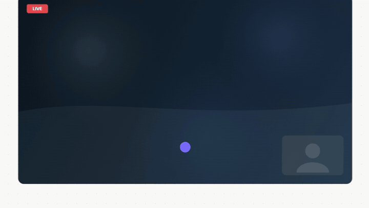

# Relayscope

A real-time tracker for the Donation Relay program on Solana (`RLAYHr9TRFcKB2ubYQhspcnXiaGpaVzNQvHytt47RZu`).

Relayscope follows every donation from the donor's transaction to the payout, checks that every epoch balances, and gives streamers and integrators a live feed, an OBS overlay and signed webhooks.

[](https://vignesh-chaturvedi.github.io/relayscope/)

[Watch the 45-second demo](https://vignesh-chaturvedi.github.io/relayscope/): one real mainnet donation, from the stream alert to the payout and the checks.

An independent, unofficial project.

**Status:** all 7 phases are done: a decoder for every instruction, event and account in the program, its full history indexed into SQLite (243,023 transactions, 0 decode failures), every epoch reconciled (49,159 epochs, 0 failed checks), live following with a recorded kill test, a web app with a receipt for every donation, an OBS overlay that showed a real donation 2 seconds after its block, signed webhooks, and a Docker image with CI. See the [build plan](docs/BUILD_PLAN.md) and the [methodology](docs/METHODOLOGY.md).

## Quickstart

Requires Docker with Compose 2.24 or newer.

```bash
git clone https://github.com/vignesh-chaturvedi/relayscope && cd relayscope

# An RPC endpoint that keeps full history, such as a free Helius key
echo 'RELAYSCOPE_RPC_URL=https://mainnet.helius-rpc.com/?api-key=YOUR_KEY' > .env

docker compose up -d          # then open http://localhost:8790
docker compose logs -f live   # watch the history load, then live blocks
```

`live` keeps the database current and `serve` runs the API, the web app and the overlay on the same volume. On an empty database, `live` first fetches the program's whole history, about 240,000 transactions, then follows new blocks. At the default pace of 3.5 requests a second that takes about 20 hours; add `RELAYSCOPE_RPS=9` to `.env` if your plan allows it (Helius's free plan did, for about 4 transactions a second). Solana's public endpoint throttles to a crawl, more than a week. The site works while it loads.

To share it, `docker compose --profile tunnel up -d` adds a Cloudflare quick tunnel; `docker compose logs tunnel` shows a temporary `trycloudflare.com` address, which changes whenever the tunnel restarts. Live pages use a WebSocket, which passes through it.

## Try the decoder

Requires Rust 1.88 or newer.

```bash
# Decode everything the relay did in a transaction
cargo run -p relayscope -- tx 3BpzeRQe9zWQrLxXzHTa7ubBdA91zLxp3WyTHcfMcMKc9LAJfghJes23JGTK46c4AhiwbjXcz7Yad3CfrgkuKqcn

# The same, as JSON
cargo run -p relayscope -- tx <signature> --json

# Check that the on-chain IDL still matches the pinned copy
cargo run -p relayscope -- idl check
```

Set `RELAYSCOPE_RPC_URL` to use your own RPC endpoint, in the environment or a local `.env` file. The default is Solana's public mainnet endpoint, which is rate limited.

## Index the full history

```bash
# List every signature, then fetch, decode and store every transaction in data/relayscope.db.
# Stop it at any time; rerunning resumes where it stopped.
cargo run --release -p relayscope -- backfill

# Counts and totals: transactions, instructions, donations by caller and mint, payouts by share type
cargo run --release -p relayscope -- stats

# After a decoder change, rebuild every table from the stored raw transactions, without refetching
cargo run --release -p relayscope -- reindex
```

## Follow it live

```bash
# Follow the program through a WebSocket on your RPC (a free Helius key works).
# Each new transaction is stored at once and rewritten when finalized. Every 10 minutes a
# repair pass fetches anything the WebSocket missed, then every check runs again.
cargo run --release -p relayscope -- live

# Prove recovery: cut the source for 5 minutes, then check every signature RPC lists for the
# window against the store, and write a report
cargo run --release -p relayscope -- live --kill-test --offline 300
```

`--source gapless` uses Solami's Yellowstone gRPC stream through gapless instead, which needs a Solami plan with gRPC access.

In the first [kill test](docs/kill-tests/2026-11-23-websocket.md), the WebSocket was down for 24 minutes while 5 transactions landed. All 5 were recovered and nothing was missing. Live transactions reached the store about 1 second after their block.

## Run the web app

```bash
# Build the web app once
cd web && npm install && npm run build && cd ..

# Serve the API, the live feed and the web app on http://127.0.0.1:8790
cargo run --release -p relayscope -- serve
```

Run `relayscope live` beside it to keep the database current. Pages:

- **Overview** `/`: totals, the latest donations with new ones arriving live, and check status.
- **Receipt** `/tx/:signature`: a donation's journey from donated to pooled, closed, swapped and paid out, with each payout line, the donation's share of it, and the epoch's checks.
- **Epoch, config and address** pages, and **Checks** `/checks`, which explains what each check proves.

The JSON API is under `/api/v1` (`overview`, `tx/:signature`, `epoch/:config/:mint/:epoch`, `config/:id`, `address/:address`, `search?q=`, `checks`), and new donations are pushed over a WebSocket (`/api/v1/live`) or server-sent events (`/api/v1/stream`), for every config or one; a client that reconnects gets what it missed. [API.md](docs/API.md) is the reference. Beneficiary names come from the operator's public API when `RELAYSCOPE_LABELS_URL` is set, and are always marked as labels rather than proof.

## Show donations on stream

Every config page links to an overlay setup page, `/config/:config/overlay`. It builds a URL for an OBS **Browser** source, shows a live preview, and sends test alerts to place the alert in a scene.

The overlay, `/overlay/:config`, is a transparent page with no framework (about 7 kB). Each new donation shows as a card with the amount, the donor or the program that sent it, and the donor's message. Its options live in the URL:

| Option | Default | |
| --- | --- | --- |
| `messages=0` | on | Hide donor messages. When shown, links and hidden characters are removed. Donations made by other programs never show one, since a program writes its own data there. |
| `length=` | 120 | Longest message, 20 to 280 characters, cut with an ellipsis. |
| `seconds=` | 8 | How long each alert stays up, 3 to 30. When alerts queue up, each shows for half as long. |
| `automatic=0` | on | Skip donations other programs make, such as pump.fun creator fees, and show only people donating. |
| `theme=light` | dark | A light card instead of a dark one. |
| `key=` | | The random key the setup page makes, so only you can send test alerts to your overlay. |

## Send webhooks

```bash
relayscope webhooks secret                      # a signing secret for your endpoint
relayscope serve --webhooks webhooks.toml       # see examples/webhooks.toml
relayscope webhooks status                      # delivered, pending and failed, by endpoint
```

Relayscope sends `donation.made`, `epoch.closed`, `epoch.settled` and `check.failed` to each endpoint that subscribed. Requests are signed as the [Standard Webhooks](https://www.standardwebhooks.com) spec describes, every event has a stable ID, and failed deliveries are retried with backoff for about 22 hours from an outbox that survives restarts. [WEBHOOKS.md](docs/WEBHOOKS.md) has the payloads and how to verify them, and [`examples/webhook-receiver`](examples/webhook-receiver/receiver.mjs) is a receiver with no dependencies that checks every signature.

## Reconcile every epoch

```bash
# Run checks C1 to C8 on every epoch, store the results in the checks table and print a report
cargo run --release -p relayscope -- verify
```

The checks are plain arithmetic over on-chain data: donations add up to each closed epoch, every swap delivered what it reported, every payout adds up and arrived with its recipients, the fee is a known rate, and tips were paid. [METHODOLOGY.md](docs/METHODOLOGY.md) gives each rule and what the full history showed.

The backfill needs an RPC endpoint that keeps full history. Solana's public endpoint does, but it throttles hard: a trial settled at about 0.3 transactions a second, more than nine days for the program's history. With an archival endpoint, set `RELAYSCOPE_RPC_URL` and raise `--rps` and `--concurrency`. The client slows itself down whenever it is rate limited, so a too-high `--rps` costs time, not correctness.

## How decoding is checked

- **Against the IDL.** The program's IDL is pinned in [`idl/`](idl/) with its SHA-256. A test compares every Rust type with it, field by field: 15 instructions, 7 events, 7 accounts, 8 shared types and 34 errors. `relayscope idl check` compares the pinned copy with the chain.
- **Against real transactions.** 18 mainnet transactions in [`fixtures/`](fixtures/) decode to golden files in [`fixtures/decoded/`](fixtures/decoded/), and hand-written tests assert the values that matter: amounts, PDAs, which program made the call, and that every payout line arrived in its recipient's token account.
- **Strictly.** In a successful transaction, an unknown discriminator or data that does not match the layout exactly is an error, so a program upgrade cannot be silently misread. A failed transaction changed nothing, so an unreadable call in one is recorded instead.

## License

MIT
